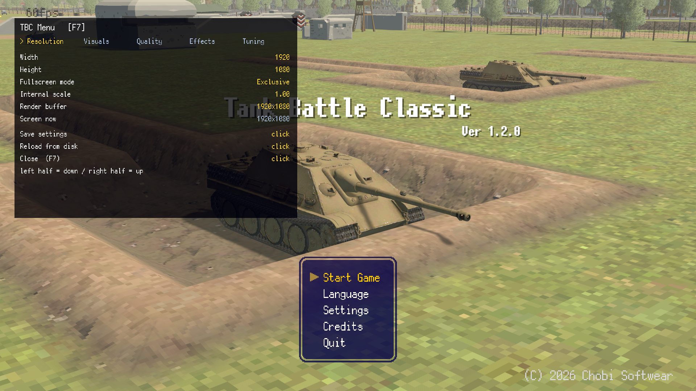
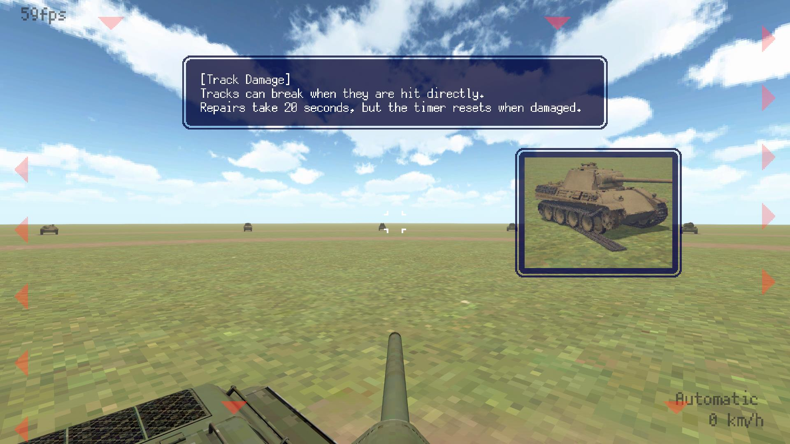

# TBC Menu

MelonLoader mod for **Tank Battle Classic**. Adds an in-game settings menu (F7) for things the
game does not expose: real screen resolution and native-resolution rendering, the post-process
filter, URP quality settings, per-tank vehicle values and optional gameplay/AI tuning.

Unofficial. Contains no game content. Buy the game:
https://store.steampowered.com/app/5086560/Tank_Battle_Classic/

Author: **murkzuk** - https://github.com/murkzuk

**Built by DeepSeek** - an AI agent wrote the code, did the reverse engineering behind
[docs/graphics-notes.md](docs/graphics-notes.md) and [docs/vehicle-model.md](docs/vehicle-model.md),
and wrote this documentation, at murkzuk's request. murkzuk asked for it, directed the work, tested
it, and owns the result.

## Why this exists

The game ships locked to your desktop resolution and renders the 3D view into a fixed
**854x480 point-filtered buffer**, then stretches it to the window over a post-process stack of
film grain 0.5, chromatic aberration 0.15 and vignette 0.2. That combination is the whole "PS1
filter": the art itself is full resolution (2048x2048 albedos), and none of it is exposed in the
game's Settings menu.

This mod removes the filter and makes the pipeline adjustable at runtime - including, since 1.7,
drawing the 3D view at native resolution instead of into that buffer, in every camera mode:
third person, gun sight and map (the last two since 1.7.1). The background, the measured numbers
and the traps are in [docs/graphics-notes.md](docs/graphics-notes.md).

## Requirements

- **MelonLoader 0.7.3** (IL2CPP build). BepInEx does **not** work on this game - see the notes.
- Windows x64.

## Install

1. Install MelonLoader into the game (the installer picks IL2CPP automatically):
   https://github.com/LavaGang/MelonLoader/releases
2. Launch once so MelonLoader generates its Il2Cpp assemblies, then close the game.
3. Drop `TBC_Menu.dll` into `<game>\Mods\`
4. Launch. Press **F7** in game.

Config lives at `<game>\UserData\TBC_Menu.json` and is written by **Save settings** in the menu.
Nothing is written unless you press it.

## Uninstall

Delete `Mods\TBC_Menu.dll` and `UserData\TBC_Menu.json`. To remove MelonLoader entirely,
delete `version.dll`, `MelonLoader\`, `Mods\` and `UserData\` from the game folder; Steam's
"verify integrity" does the same.

## The menu

`F7` opens it. Rows: **left half of the value area decreases, right half increases**. ON/OFF rows
toggle, choice rows cycle. The cursor is unlocked while it is open and the gun is muted, so
clicking cannot fire.

| Tab | What it controls |
|---|---|
| **Resolution** | window size, fullscreen mode, **Render direct to screen**, internal buffer scale (0 = stock buffer - leave it there, see below), live buffer readout |
| **Visuals** | film grain, chromatic aberration, vignette, fog density, antialiasing (off/fxaa/smaa/taa), dithering, texture aniso, **commander view** |
| **Quality** | MSAA 1-8x, main light shadowmap 1024-4096, soft shadow quality, shadow distance, render scale (supersampling) |
| **Effects** | tonemapping (none/neutral/ACES), bloom + threshold, exposure, contrast, saturation |
| **Vehicle** | per-tank top speed, turret traverse, gun elevation, acceleration and torque, plus a realism table and a live speed readout |
| **Tuning** | tuning multiplier scales, max tuning levels, AI preset and scales, AI passive, unlock all tanks, points |

**F8** dumps the render/UI geometry to `MelonLoader\Latest.log` (cameras, viewport rects, canvases,
canvas scalers, reticle transforms). It is a diagnostic, useful when something looks misaligned.

## Sharp rendering, and the aiming trap

The 854x480 buffer caps detail: supersampling inside the pipeline cleans edges but cannot add any,
because the result is still 854x480 and then stretched.

**Render direct to screen** (`resolution.bypass_buffer`, Resolution tab) fixes that. The 3D cameras
draw to the window instead of into the buffer and the canvas that stretches the buffer is hidden,
so the picture is native resolution.

It has one non-obvious requirement. The game converts the reticle's screen position into buffer
pixels using `General_Settings_CS.Render_Texture_Width` / `Render_Texture_Height` - **static fields
initialised to 854x480**, never read from the real surface. Anything that changes where the 3D view
is drawn has to be mirrored in those two fields, or the aim goes wrong. Measured in game:

| change | aim |
|---|---|
| stock (854x480 buffer) | correct |
| resize the buffer to 1920x1080 (`internal_scale`) | gun trails left and low of the crosshair, worse away from centre |
| draw to the screen, buffer canvas hidden, constants left alone | **same error** |
| draw to the screen **and** set the constants to the surface size | **correct, and sharp** |

So the bypass sets those constants and restores them when switched off, `internal_scale` defaults
to 0 (its row is labelled "breaks aim"), and for a safe but softer improvement use
**Quality -> Render scale**. MSAA, anisotropy, shadows and the post effects are safe either way.

There is a second half to it. The buffer is shared: `Gun_Camera` and `Camera (Map)` are only
created when you switch into the gun sight or the map, so they have to be redirected as they
appear rather than once at scene load. 1.7.0 redirected once and both views came up blank - the
dark scope disc with a reticle over it, and an empty map. Since 1.7.1 the redirect is maintained
every frame, and both views draw at native resolution. Measured proof that the aim survives it:
a gun-sight kill at **247 m** with one shot, `Hit_Ratio 100.0` and `Penetration 60.6/30.0 mm` on
the game's own results screen.

## Commander view (F6)

The game only has third person, the gun sight and the map. **F6** adds a first-person seat on the
turret.

The camera keeps its original parent - it must **not** be parented to the turret. This game slaves
the turret to the camera's forward direction (`Aiming_Control_CS`), so a turret-parented camera
creates a feedback loop and the turret spins endlessly (fixed in 1.2.1). Instead the observer point
is placed on the turret and the camera's world pose is driven directly every frame, with
`Camera_Pivot_CS`, `Camera_Rotation_CS`, `Camera_Avoid_Obstacle_CS` and `Camera_Zoom_CS` suspended.

| Setting | Meaning |
|---|---|
| `commander_height` / `commander_forward` | eye offset from the turret origin, in metres |
| `commander_fov` | field of view (30-110) |
| `commander_free_look` | `false` = the view rides the turret and the mouse trains the gun as usual. `true` = the mouse looks around while the gun stays put (`Aiming_Control_CS` is suspended; firing still works) |
| `commander_sensitivity` | free-look sensitivity |

Notes: the tank's own body is what you are sitting on, so you see the deck and barrel in frame.

The seat is a *request* rather than a one-shot switch, so it survives the game taking the camera
away:

- Pressing `F6` **while the gun sight (or the map) is up** leaves that view and takes the seat -
  the manager's camera mode is reset instead of the seat giving up.
- Switching to the gun sight yourself while seated hands the camera over and the seat **comes back
  by itself** when you leave the gun sight. The same happens on `Restart` and on scene changes, so
  the seat follows you into the next mission.
- `F6` pressed while a scene is still loading waits for the tank to appear (up to a few seconds)
  instead of failing on that frame.
- `camera.commander_view` = `true` enters the seat automatically in the next mission.

## Vehicle overrides

The game quantises every vehicle into two speed brackets (35 or 40 km/h) and models turret
traverse several times too fast, so a Tiger I and a T-34/76 end up 5 km/h apart and both turrets
snap around like a tank in an arcade game. This tab replaces those numbers per tank, in real units:

    "vehicle": {
      "enabled": true,
      "player_only": false,
      "per_tank": {
        "T-34/76": { "max_speed": 14.7, "traverse": 5.0, "accel_time": 24.0 },
        "Tiger I": { "max_speed": 12.7, "traverse": 8.0, "accel_time": 26.0 }
      }
    }

| Key | Unit | Meaning |
|---|---|---|
| `max_speed` | m/s | top speed (14.7 = 53 km/h) |
| `traverse` | deg/s | turret traverse |
| `elevation` | deg/s | gun elevation |
| `accel_time` | s | standstill to full speed |
| `decel_time` | s | full speed to standstill |
| `torque_scale` | x | multiplies the game's wheel torque (slopes only, see below) |

Entries are keyed by `Tank_Prop_SO.Tank_Name` ("T-34/76", "Tiger I"); the **Tank** row in the menu
cycles through the tanks in the current mission and edits the selected one. **Load realism table**
fills in the values for the whole roster; **Dump vehicle values** writes every live value, including
the drive flags and world positions, to `UserData\TBC_Vehicles.json`.

Two things worth knowing before you tune:

- **Torque is not the speed or acceleration lever.** Measured in game, 2100 and 3000 torque
  produced identical acceleration: the wheels are already at their angular-velocity cap and the
  hull is traction-limited. Top speed is `maxAngVelocity * wheel radius`, and that cap is a
  private field the wheel parent computes once from `Max_Speed` - which is why the mod re-runs it.
- **The ramp is the lever.** `Acceleration_Time` only takes effect when `Acceleration_Flag` is on,
  `Sync_Speed_Rate` is off, and the cached `acceleRate` is refreshed; the mod sets all three when
  `accel_time` is given. That is what stops every tank accelerating like a go-kart. Note it
  disables the game's speed synchronisation for that tank, which has not been tested on hills.
- **Historical turret traverse is slow.** 5 deg/s (T-34/76) means a 30 degree swing takes six
  seconds while the crosshair moves instantly, so the gun visibly trails the reticle. That is
  realism fighting the game's mouse aiming, not a bug - soften the `traverse` values if it bothers
  you, or drop the key entirely to keep the stock rate.

The full reverse-engineering write-up, with field offsets and the measured curves, is in
[docs/vehicle-model.md](docs/vehicle-model.md).

## Custom scenarios

[docs/terrain-and-scenarios.md](docs/terrain-and-scenarios.md) covers what a map is in this game,
how the six shipped terrains measure up, and how to build a custom scenario (including stretching a
terrain's horizontal scale to turn steep gullies into rolling ground). That work uses the separate
[TankBattleMissionEditor](https://github.com/fiermanb/TankBattleMissionEditor); nothing in this mod
touches game files.

## Defaults

Resolution, the visual cleanup and **Render direct to screen** are on; quality is raised (MSAA 8x,
2048 shadowmap, high soft shadows, 200 m shadow distance, render scale 2); effects, tuning and
vehicle overrides are **off**.

## Compatibility

Built and tested against:

- game version **1.2.0**
- Unity **6000.2.10f1**
- `global-metadata.dat` sha256 `510415579aab976aca8135b23a69640dfa7ebb00f5610fb15ff02e7568b925d6`

The mod reads IL2CPP field names through the generated interop assemblies, so a game update can
break it. If the fields move, rebuild against the new interop assemblies.

## Known limitations

See [TODO.md](TODO.md) for the backlog and the measured game-vs-real-life data.

- Unity stripped the IMGUI module from this build, so the UI is uGUI with manual hit-testing.
  It is not resizable or scrollable; it is a panel with fixed rows.
- **Render direct to screen covers all three camera modes** (third person, gun sight, map) since
  1.7.1, and the aiming correction is verified by measurement, not by eye. The one place it can
  still pick the wrong texture is a briefing screen, which carries a second 256x256 minimap
  buffer; battle scenes are unaffected. If something looks wrong, turn the toggle off - it takes
  effect immediately.
- The bypass hides the canvas that displays the buffer. Anything the game draws into that buffer
  other than the 3D view will not appear.
- Effects are added to the scene's volume profile at runtime. If the game ever ships its own
  Bloom/Tonemapping components, the mod will use those instead of creating new ones.
- The **Tuning** tab writes into live player data, which the game saves on exit. Back up
  `%USERPROFILE%\AppData\LocalLow\Chobi Softwear\Tank Battle Classic\save.json` before using
  *Unlock all tanks* or *Points*.

## Building

Requires the .NET 6 SDK (or newer) and an installed copy of the game with MelonLoader.

    powershell -ExecutionPolicy Bypass -File tools/find-game.ps1
    powershell -ExecutionPolicy Bypass -File build.ps1

`tools/find-game.ps1` writes `game.path` (gitignored). You can also set the `TBC_GAME_DIR`
environment variable, create a `Local.props` with `<GameDir>...</GameDir>`, or pass
`-p:GameDir="D:\...\Tank Battle Classic"`.

`build.ps1` produces `dist\TBC_Menu-<version>.zip` containing the DLL, README and licence.

Source layout: `MenuMod.cs` (lifecycle and state), `Config.cs` (JSON shape and IO),
`Apply.cs` (resolution, buffer bypass, visuals, quality, effects, tuning), `Vehicle.cs` (per-tank
vehicle overrides), `Camera.cs` (commander view), `MenuUi.cs` (the uGUI menu),
`Diag.cs` (the F8 geometry dump).

## Credits

- **Built by DeepSeek** (AI), at the request of **murkzuk**. The mod, the reverse-engineering
  notes and this README were produced by the model; every step was driven by murkzuk's requests and
  validated by running the game.
- **Requested, directed and tested by murkzuk** (https://github.com/murkzuk), who owns the result.
- Thanks to **fierman** for
  [TankBattleMissionEditor](https://github.com/fiermanb/TankBattleMissionEditor), whose approach
  to regenerating the game's stripped type trees is described in the notes.

## Licence

MIT - see [LICENSE](LICENSE).

Not affiliated with Chobi Softwear. No game assets are included or redistributed.
